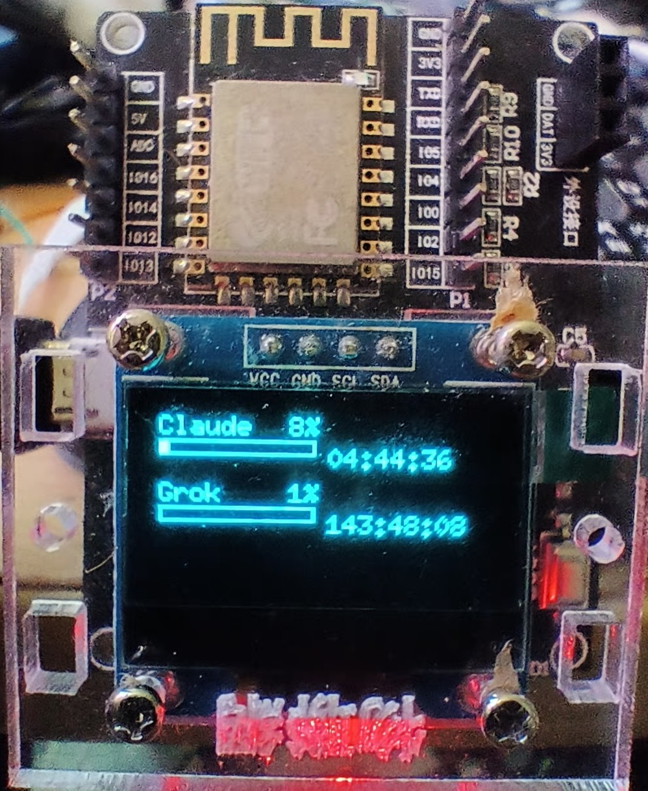
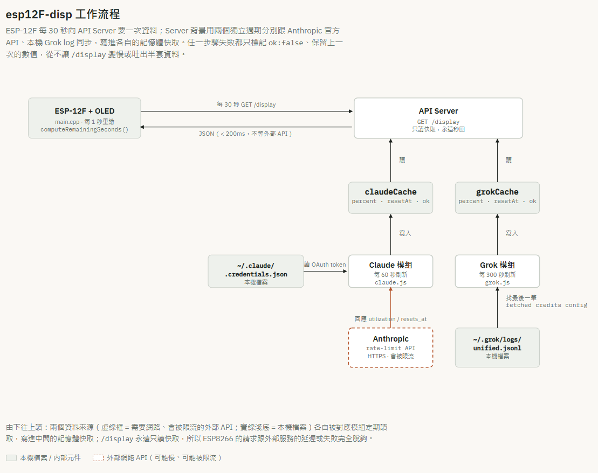

# esp12F-disp

用一片 ESP-12F（ESP8266）接 0.96 吋 I2C OLED，顯示 Claude Code 與 Grok 的額度使用率與重置倒數，資料由一個跑在 Docker 裡的 API server 提供。



## 功能特色
- Claude Code 5 小時額度使用率 % 與重置倒數（讀 Anthropic 官方 rate-limit API）
- Grok 額度使用率 % 與重置倒數（讀本機 Grok CLI 的 log）
- 任一資料來源失敗時優雅降級（保留最後已知數值、標記 `ok:false`），不會讓畫面顯示亂七八糟的東西
- ESP8266 端畫面本地做每秒倒數動畫，不用每秒都打 API

## 運作原理



幾個關鍵設計：

1. **`GET /display` 永遠秒回**：這支端點只讀記憶體裡已經算好的快取，不會因為外部 API 慢或掛掉而被卡住。真正會花時間的「打 Anthropic API」「讀 log 檔案」都在背景計時器裡跑，跟服務請求完全分開。
2. **倒數用絕對時間、查詢時才換算**：快取存的是「什麼時候重置」的絕對時間點（`resetAt`），不是刷新當下算好的秒數快照。每次 `/display` 被呼叫時才用 `現在時間` 去換算剩餘秒數，這樣兩次刷新之間倒數還是會持續正確地減少，而不是卡在上次刷新的那個數字上。
3. **資料來源異常時保留舊值**：不管是 token 過期、API 回應打不開、還是暫時讀不到 log 檔案，快取都只會把 `ok` 標成 `false`，但不會把已經有的 `percent`/`resetSeconds` 洗掉；要等到「完全沒有任何成功過的資料」才會回 `null`。ESP8266 那邊看到 `ok:false` 但有數字，照樣正常顯示（只是知道這可能是舊資料），真正顯示 `N/A` 的情況只有「這個服務從來沒成功同步過」。
4. **ESP8266 端只管畫面，不管資料正確性判斷的細節**：韌體每 30 秒拉一次 `/display`，拿到的 `resetSeconds` 存成本地基準值，之後每秒用 `millis()` 自己算剩餘秒數並重繪畫面；WiFi 斷線、或超過 2 分鐘沒同步成功，畫面上會分別顯示對應提示。

更完整的功能需求與異常情境定義在 [docs/SRS.md](docs/SRS.md)，API 的詳細 request/response 格式在 [docs/API.md](docs/API.md)。

## 技術棧
- **API server**：Node.js + Express，內建 `node:test` 測試（不依賴外部測試框架）
- **韌體**：PlatformIO + Arduino framework（ESP8266），ArduinoJson、U8g2；純邏輯部分用 PlatformIO `native` 環境跑 Unity 測試，不需實體硬體
- **容器化**：Docker + docker-compose
- **資料庫**：無（純記憶體快取，程序重啟即清空，下次背景刷新會重新填入）

## 專案結構
```
esp12F-disp/
├── docs/
│   ├── SRS.md                 # 軟體需求規範書
│   ├── API.md                 # API 規格書
│   ├── STYLE_GUIDE.md         # 程式碼規範
│   ├── TROUBLESHOOTING.md     # 疑難排解
│   └── DEVELOPMENT_LOG.md     # 開發日誌
├── server/                    # Docker API server
│   ├── src/{claude,grok,index}.js
│   └── test/
├── firmware/                  # PlatformIO 韌體
│   ├── lib/usage_state/       # 可離線測試的純邏輯
│   ├── src/main.cpp           # WiFi / HTTP / OLED
│   ├── scripts/gen_secrets.py # 從根目錄 .env 產生 include/secrets.h
│   └── tools/i2c_scanner/     # 接線診斷用小工具（非主韌體）
├── .env.example                # 環境變數範例
├── docker-compose.yml
└── CHANGELOG.md
```

## 快速開始

### 環境需求
- Docker + Docker Compose
- 主機已用 `claude` 指令登入過（`~/.claude/.credentials.json` 存在）
- 主機已安裝並至少執行過一次 Grok CLI（`~/.grok/logs/unified.jsonl` 存在）
- PlatformIO（燒錄韌體用）；ESP-12F + 0.96" I2C OLED（SSD1306 控制器）

### 環境變數設定
```bash
cp .env.example .env
# 編輯 .env：填入實際 WIFI_SSID / WIFI_PASSWORD，
# 以及 ESP8266 能從它所在的 WiFi 網段連到的 API_BASE_URL
```
> 注意：如果 Docker 跑在多張網卡的機器上（例如 Windows + Docker Desktop + WSL2），`API_BASE_URL` 要填 **ESP8266 實際 WiFi 網段能連到的那張網卡 IP**，不一定是看起來「主要」的那張。

### 啟動 API Server
```bash
docker compose up -d --build
curl localhost:8787/display   # 確認回應正常
```

### 燒錄韌體
```bash
cd firmware
pio run -e esp12e -t upload --upload-port <你的序列埠>
```
`platformio.ini` 設定了 `extra_scripts = pre:scripts/gen_secrets.py`，會在建置前自動從根目錄 `.env` 產生 `include/secrets.h`（不進版本控制）。

### 跑測試
```bash
# API server
cd server && npm test

# 韌體純邏輯（不需實體硬體）
cd firmware && pio test -e native
```

## 文件索引
- [軟體需求規範書 (SRS)](docs/SRS.md)
- [API 規格書](docs/API.md)
- [程式碼規範](docs/STYLE_GUIDE.md)
- [疑難排解](docs/TROUBLESHOOTING.md)
- [開發日誌](docs/DEVELOPMENT_LOG.md)
- [CHANGELOG](CHANGELOG.md)

## 授權
TBD
